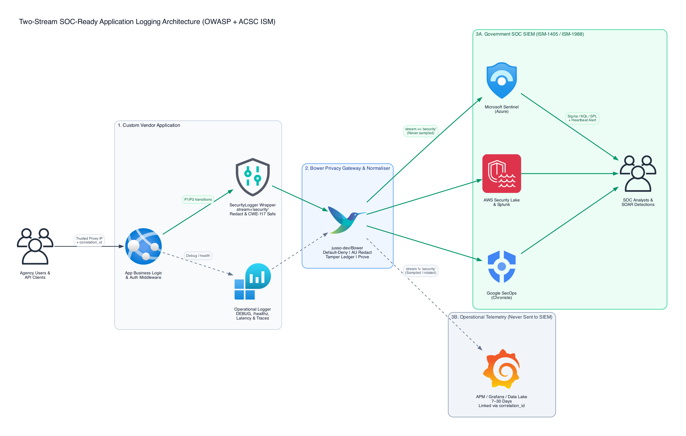
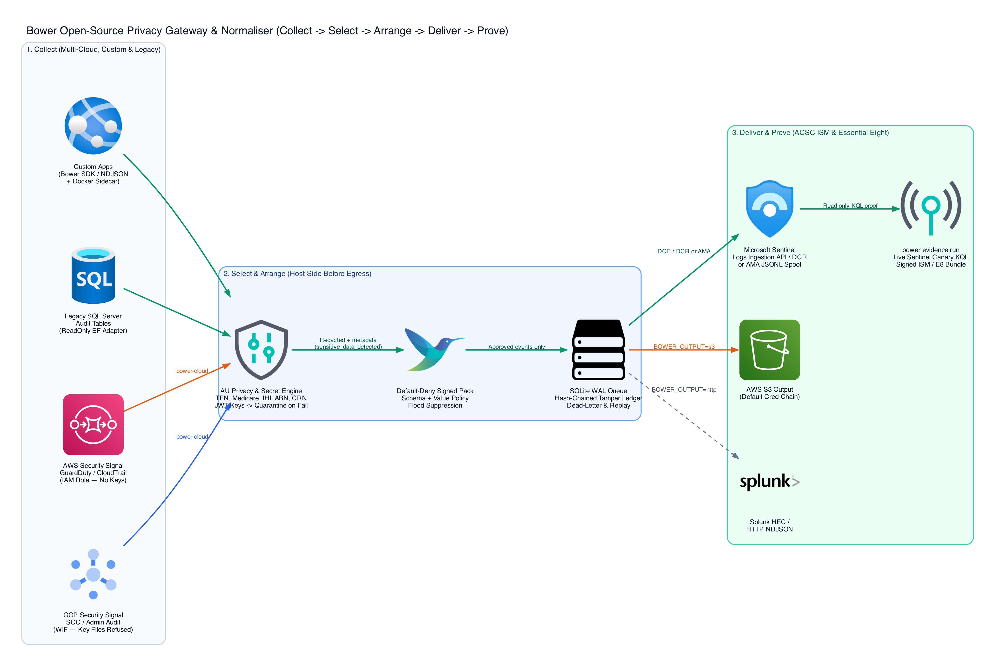
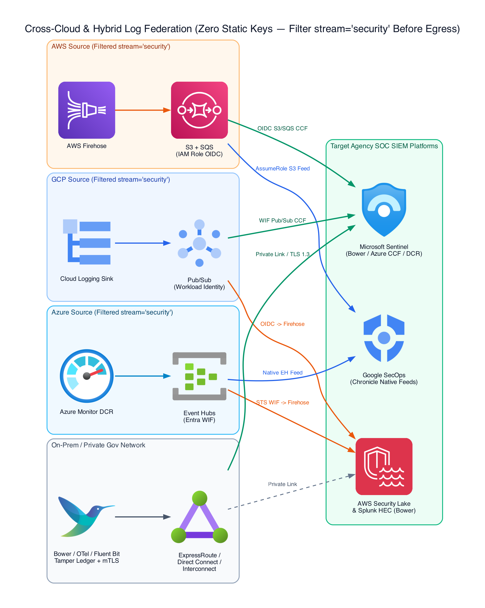
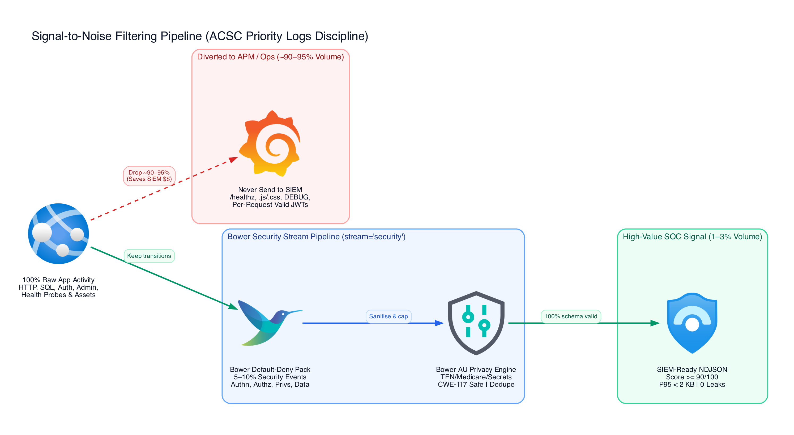
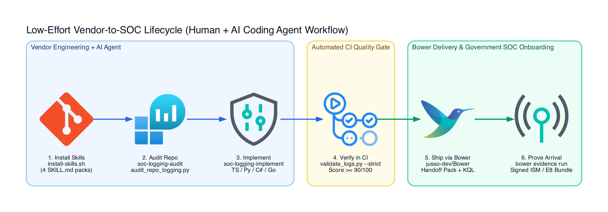

# soc-ready-logging

[](https://github.com/jusso-dev/soc-ready-logging/actions/workflows/ci.yml)
[](./LICENSE)
[](./docs/04-owasp-and-acsc-mapping.md)
[](https://github.com/jusso-dev/Bower)

**High-value, low-noise, security-centric logging for custom software vendors building for Government and Enterprise SOC teams — designed to pair directly with our open-source security log normaliser and Australian privacy gateway, [Bower](https://github.com/jusso-dev/Bower).**

> [!TIP]
> **Don't build a log normaliser, PII redactor, tamper-evident queue, or Sentinel arrival prover from scratch.**
> Use **[jusso-dev/Bower](https://github.com/jusso-dev/Bower)** ([Docs](https://jusso-dev.github.io/Bower/) · [Integration Guide](./docs/12-normalising-and-shipping-with-bower.md)) alongside this repo. Bower runs **Collect → Select → Arrange → Deliver → Prove** on-host: default-deny security policies, deterministic checksum-validated Australian PII/secret redaction (TFN, Medicare, IHI, ABN/ACN, CRN, keys/JWTs), a hash-chained SQLite WAL ledger, multi-cloud AWS/GCP/SQL Server normalisation, and `bower evidence run` signed Sentinel arrival bundles.

Aligned to **OWASP** (Logging Cheat Sheet, Application Logging Vocabulary, ASVS v4.0.3 V7 & v5.0 V16, Top 10 A09) and **ACSC / ASD** (Information Security Manual System Monitoring, *Best Practices for Event Logging and Threat Detection*, and *Priority Logs for SIEM Ingestion*)—complete with **Azure, AWS, GCP & Cross-Cloud federation guides**, **Diagram-as-Code architecture diagrams with official cloud icons**, **zero-dependency CLI scripts**, **drop-in language wrappers**, **starter SIEM detections**, and **portable AI coding agent skills**.

## Part of the Microsoft security logging stack

1. **[microsoft-security-logging-guide](https://github.com/jusso-dev/microsoft-security-logging-guide)** — What to log: practical, product-by-product guidance on getting high-value security logs from Microsoft products into Microsoft Sentinel and Microsoft Defender XDR.
2. **[soc-ready-logging](https://github.com/jusso-dev/soc-ready-logging)** *(you are here)* — How to instrument custom applications: OWASP and ACSC ISM schemas, CLI validators, language wrappers, starter detections, and AI agent skills for high-value, low-noise security logging.
3. **[Bower](https://github.com/jusso-dev/Bower)** — How to normalise, redact, and ship logs: self-hosted security telemetry normaliser and Australian privacy gateway with default-deny selection, host-side PII redaction, tamper-evident buffering, and signed Sentinel arrival proof.
4. **Operate on the logs in Microsoft Defender XDR and Microsoft Sentinel:**
   - **[blueboard](https://github.com/jusso-dev/blueboard)** — Shared board where AI agents and SOC analysts work incidents together across Microsoft Defender XDR and Microsoft Sentinel, with human-approved containment and eradication.
   - **[crosswire](https://github.com/jusso-dev/crosswire)** — Open-source SOC kit for GitHub Copilot and Squad agents that hunt in Microsoft Defender XDR and Microsoft Sentinel, cross-compare threat intelligence, and propose gated responses for human approval.

---



---

## Featured Open-Source Normaliser & Privacy Gateway: [Bower](https://github.com/jusso-dev/Bower)

Need an open-source, self-hosted gateway that enforces **default-deny security selection, host-side Australian PII redaction, tamper-evident buffering, multi-cloud normalisation, and signed Sentinel arrival proof** out of the box?

Pair this repository with **[jusso-dev/Bower](https://github.com/jusso-dev/Bower)** ([Docs](https://jusso-dev.github.io/Bower/) · [Integration Guide](./docs/12-normalising-and-shipping-with-bower.md)):

- **Collect → Select → Arrange → Deliver → Prove**: Default-deny versioned policies reject noise before persistence; only approved semantic security events pass.
- **Australian-first host-side Privacy & Secret Protection Engine**: Deterministic checksum validation for **TFN, Medicare, IHI, ABN/ACN, payment cards** plus **CRN**, JWTs, cloud keys, and PEM secrets *before data leaves the host*—quarantining on failure and emitting `sensitive_data_detected` to your SOC.
- **Multi-cloud & legacy on one contract**: Normalises custom apps (Bower SDK + `AGENTS.md`), legacy SQL Server audit tables, Docker containers, Windows Event Logs, **AWS** (GuardDuty, Security Hub, high-value CloudTrail via SQS/Firehose—no stored cloud keys), and **GCP** (SCC & Admin Audit via Pub/Sub—WIF only, key files refused) into **Microsoft Sentinel** (Logs Ingestion API / AMA spool), **S3**, or **Splunk HEC / HTTP NDJSON**.
- **Tamper-evident ledger & IRAP/ATO proof**: Hash-chained SQLite WAL queue ledger, DCR generator & drift checks, plus `bower evidence run` to verify a live canary inside Sentinel and sign an **ACSC ISM / Essential Eight** evidence bundle.



---

## Why This Exists

Government SOC teams spend far too much time fighting custom applications that either:
1. **Flood the SIEM with 95% noise** (`/healthz`, static assets, `DEBUG` traces, per-request JWT checks), inflating 12-month retention costs and burning out analysts; or
2. **Miss the fundamentals** (no UTC timestamps, proxy IPs instead of client IPs, free-text strings, missing authz/privilege/export events, or leaked Bearer tokens and citizen PII).

This toolkit gives vendors and government buyers **one clean contract** and **automated tooling + AI agent skills** to get it right on the first try.

---

## 60-Second Quickstart

### Option A — Ship & Normalise Through [Bower](https://github.com/jusso-dev/Bower) (Recommended for Gov & Sentinel)

Let **[Bower](https://github.com/jusso-dev/Bower)** handle default-deny noise rejection, host-side Australian PII redaction (TFN, Medicare, IHI, ABN/ACN, CRN), tamper-evident queuing, multi-cloud AWS/GCP/SQL Server normalisation, and signed Sentinel arrival proof (`bower evidence run`):

```bash
git clone https://github.com/jusso-dev/Bower.git
cd Bower

# Run Bower locally (selects, redacts, queues & spools JSONL for Sentinel/AMA)
BOWER_SINGLE_TRUST_DOMAIN=true \
BOWER_QUEUE_PATH=./artifacts/bower.db \
BOWER_POLICY_DIRECTORY=./policies/default \
BOWER_OUTPUT=ama-spool \
BOWER_AMA_SPOOL_PATH=./artifacts/spool \
dotnet run --project src/Bower.Collector
```

See [`docs/12-normalising-and-shipping-with-bower.md`](./docs/12-normalising-and-shipping-with-bower.md) and the [Bower Getting Started Guide](https://jusso-dev.github.io/Bower/getting-started/) for SDK, Azure Logs Ingestion API, S3, Splunk HEC, AWS `bower-cloud`, and GCP Pub/Sub setups.

### Option B — Let Your AI Coding Agent Instrument Your App + Bower

Install the 4 portable `SKILL.md` skills into **Claude Code, Codex, Cursor, Antigravity, GitHub Copilot, or OpenCode**:

```bash
git clone https://github.com/jusso-dev/soc-ready-logging.git
cd soc-ready-logging

# Install into your vendor repository (.agents/skills, .claude/skills, .cursor/skills)
./scripts/install-skills.sh --target all-project --project-dir /path/to/your-app
```

Then ask your coding agent inside your application repo:
1. *"Use `soc-logging-audit` to audit this repo's logging for OWASP and ACSC SOC readiness."*
2. *"Use `soc-logging-implement` to wire the two-stream SecurityLogger (and Bower integration) across all P1 security boundaries."*
3. *"Use `soc-logging-verify` to test redaction, CWE-117 injection safety, and verify Signal-to-Noise >= 90."*
4. *"Use `soc-handoff-pack` to generate our Day-1 Government SOC Handoff Pack, Bower evidence checklist, and starter KQL/Sigma detections."*

*(Using a chat assistant without skill loading? Copy-paste from [`templates/vendor-agent-prompt-pack.md`](./templates/vendor-agent-prompt-pack.md).)*

### Option C — Run the Zero-Dependency CLI Gates Directly

All scripts use **Python 3.9+ standard library only**—no `pip install`, works in restricted or air-gapped government build pipelines:

```bash
# 1. Validate a log capture against schema, OWASP taxonomy, secret/PII redaction, & CWE-117 safety
python3 scripts/validate_logs.py schemas/examples/valid-events.ndjson --strict

# 2. Score Signal-to-Noise quality (0-100) + SIEM GB estimate per 1M events
python3 scripts/score_signal_noise.py schemas/examples/valid-events.ndjson --min-score 90

# 3. Audit an application codebase for secret/PII log leaks, noise, & missing canonical events
python3 scripts/audit_repo_logging.py /path/to/your-app --markdown

# 4. Generate synthetic attack & heartbeat NDJSON events for UAT SIEM testing
python3 scripts/generate_test_events.py --app-id gov-grants-portal --scenario all --out tmp/uat-test.ndjson

# 5. Generate a tailored Day-1 Government SOC Handoff Pack
python3 scripts/generate_soc_handoff.py --app-id gov-grants-portal --app-name "Grants Portal" --from-ndjson tmp/uat-test.ndjson --out docs/SOC-HANDOFF-PACK.md
```

---

## Cloud & Cross-Cloud Reference Architectures (Azure, AWS, GCP & Hybrid)

Vendor hosting and agency SOC SIEMs frequently span different clouds. Dedicated guides and official-icon diagrams cover each cloud and every inter-cloud path using **zero static secrets** (OIDC / Workload Identity Federation / Managed Identity) and **filtering before egress**:

| Cloud / Scenario | Implementation Guide | Architecture Diagram |
|---|---|---|
| **Microsoft Azure & Sentinel** | [08 — Azure & Sentinel Guide](./docs/08-azure-logging-guide.md) | [`cloud-azure-sentinel.png`](./diagrams/cloud-azure-sentinel.png) |
| **Amazon Web Services (AWS)** | [09 — AWS & Security Lake Guide](./docs/09-aws-logging-guide.md) | [`cloud-aws-security-lake.png`](./diagrams/cloud-aws-security-lake.png) |
| **Google Cloud Platform (GCP)** | [10 — GCP & Google SecOps Guide](./docs/10-gcp-logging-guide.md) | [`cloud-gcp-secops.png`](./diagrams/cloud-gcp-secops.png) |
| **Cross-Cloud & Hybrid Federation** | [11 — Cross-Cloud Log Federation](./docs/11-cross-cloud-log-federation.md) | [`cross-cloud-log-federation.png`](./diagrams/cross-cloud-log-federation.png) |



---

## Signal-to-Noise Discipline



---

## Repository Map

| Directory | What's Inside |
|---|---|
| [`docs/`](./docs/) | 12 practical guides: [Why SOC Logs Fail](./docs/01-why-soc-logs-fail.md), [Taxonomy & Schema](./docs/02-event-taxonomy-and-schema.md), [High-Value / Low-Noise](./docs/03-high-value-low-noise-guide.md), [OWASP & ACSC Mapping](./docs/04-owasp-and-acsc-mapping.md), [PII Redaction & Safety](./docs/05-pii-redaction-and-log-safety.md), [SOC Handoff Playbook](./docs/06-soc-handoff-and-siem-onboarding.md), [Government RFP Clauses](./docs/07-government-procurement-clauses.md), [Azure](./docs/08-azure-logging-guide.md), [AWS](./docs/09-aws-logging-guide.md), [GCP](./docs/10-gcp-logging-guide.md), [Cross-Cloud Federation](./docs/11-cross-cloud-log-federation.md), and [Normalising with Bower](./docs/12-normalising-and-shipping-with-bower.md). |
| [`schemas/`](./schemas/) | Strict Draft 2020-12 [`security-event.schema.json`](./schemas/security-event.schema.json), 32-event machine-readable [`event-catalog.json`](./schemas/event-catalog.json) (mapped to MITRE ATT&CK, OWASP ASVS, and ACSC ISM), plus golden & anti-pattern NDJSON fixtures. |
| [`skills/`](./skills/) | 4 portable Agent Skills (`soc-logging-audit`, `soc-logging-implement`, `soc-logging-verify`, `soc-handoff-pack`) with progressive-disclosure reference sheets. |
| [`scripts/`](./scripts/) | Zero-dependency Python 3 validation, signal-to-noise scoring, static repo auditing, synthetic attack generation, SOC handoff generation, and Bash skill installer. |
| [`examples/`](./examples/) | Drop-in, zero-bloat `SecurityLogger` reference wrappers in **TypeScript**, **Python**, **C# / .NET**, **Go**, and **Java** (all with `emitHeartbeat` parity). |
| [`collectors/`](./collectors/) | Drop-in starter configs for **OpenTelemetry Collector**, **Fluent Bit / ECS FireLens**, **Azure Monitor DCR (ARM)**, **AWS CloudWatch/Firehose/S3 WORM (Terraform)**, and **GCP Logging Sink + Locked Bucket (Terraform)**. |
| [`detections/`](./detections/) | Day-1 starter SOC detection rules in **Sigma**, **Microsoft Sentinel KQL**, **Splunk SPL**, and **Google SecOps (Chronicle) YARA-L**. |
| [`diagrams/`](./diagrams/) | Diagram-as-Code [`generate_diagrams.py`](./diagrams/generate_diagrams.py) (Python `diagrams`, consistent `Helvetica` font, official Azure/AWS/GCP icons) + all 8 rendered PNG diagrams. |
| [`templates/`](./templates/) | Fill-in-the-blank [SOC Handoff Pack](./templates/soc-handoff-pack.md), [UAT/ATO Acceptance Checklist](./templates/logging-acceptance-checklist.md), [Vendor AI Prompt Pack](./templates/vendor-agent-prompt-pack.md), plus [`SECURITY.md`](./SECURITY.md). |

---

## Agent-Assisted Vendor-to-SOC Lifecycle



---

## Standards & Ecosystem Notes

- **OWASP**: Logging Cheat Sheet, Application Logging Vocabulary Cheat Sheet, ASVS v4.0.3 (V7) & v5.0 (V16), Top 10 A09.
- **ACSC / ASD**: Information Security Manual (ISM) *Guidelines for System Monitoring* (`ISM-0580`, `ISM-0585`, `ISM-0988`, `ISM-1228`, `ISM-1405`, `ISM-1815`, `ISM-1988`), *Best Practices for Event Logging and Threat Detection*, *Priority Logs for SIEM Ingestion*, and Essential Eight MFA/Privileged Access visibility. *(Always verify exact ISM control wording against the live release at [cyber.gov.au/ism](https://www.cyber.gov.au/ism).)*
- **Open-Source Privacy Gateway & Normaliser**: Pair this repo with **[jusso-dev/Bower](https://github.com/jusso-dev/Bower)** ([guide](./docs/12-normalising-and-shipping-with-bower.md)) for host-side Australian PII redaction, default-deny policy enforcement, tamper-evident queueing, AWS/GCP/SQL Server/WEC normalisation, and `bower evidence run` signed Sentinel arrival proof.

## License

MIT — see [`LICENSE`](./LICENSE). Free for vendors, government agencies, integrators, and SOC teams to adopt, embed in RFPs, and adapt.
