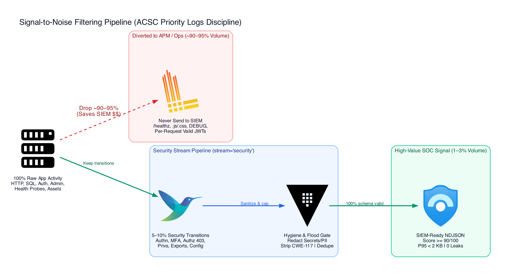
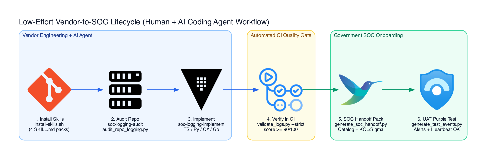
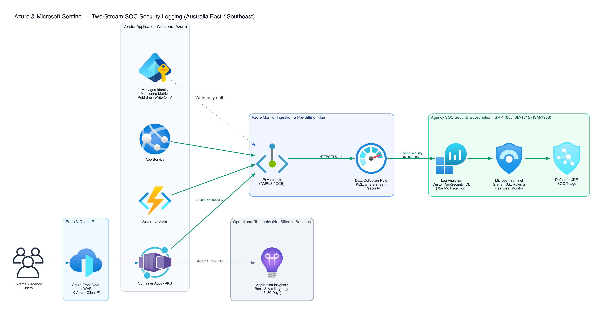
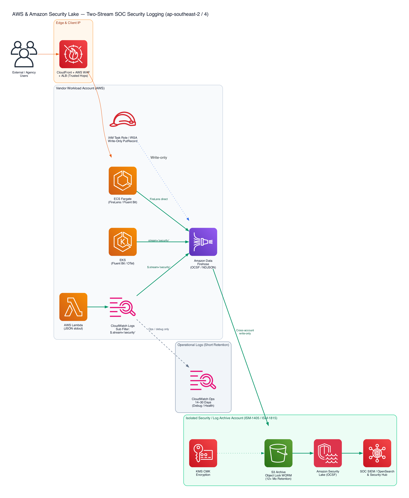

# Architecture & Cloud Diagrams (Diagram as Code)

All diagrams are generated from [`generate_diagrams.py`](./generate_diagrams.py) using the Python [`diagrams`](https://diagrams.mingrammer.com/) library (Graphviz) with:

- **One consistent font family** (`Helvetica`) across titles, clusters, nodes, and edge labels
- **Official cloud architecture icons** for **Microsoft Azure**, **Amazon Web Services (AWS)**, **Google Cloud Platform (GCP)**, and OSS / On-Premises tooling
- **Consistent color semantics**: Emerald (`stream == "security"` -> SIEM), Slate dashed (`stream != "security"` -> Operational/APM), Blue/Orange (Zero-Trust Cross-Cloud Federation)

## Regenerating Diagrams

Requires Graphviz (`brew install graphviz` or `apt-get install graphviz`) and `uv` (or `pip install diagrams`):

```bash
uv run --with diagrams python3 diagrams/generate_diagrams.py
```

---

## Core Architecture & Workflow Diagrams

### 1. Two-Stream SOC-Ready Application Logging Architecture


### 2. Signal-to-Noise Filtering Pipeline


### 3. Agent-Assisted Vendor-to-SOC Lifecycle


---

## Cloud-Specific & Cross-Cloud Diagrams (Official Cloud Icons)

### 4. Azure & Microsoft Sentinel ([Guide](../docs/08-azure-logging-guide.md))


### 5. AWS & Amazon Security Lake ([Guide](../docs/09-aws-logging-guide.md))


### 6. GCP & Google Security Operations / Chronicle ([Guide](../docs/10-gcp-logging-guide.md))


### 7. Cross-Cloud & Hybrid Log Federation ([Guide](../docs/11-cross-cloud-log-federation.md))

