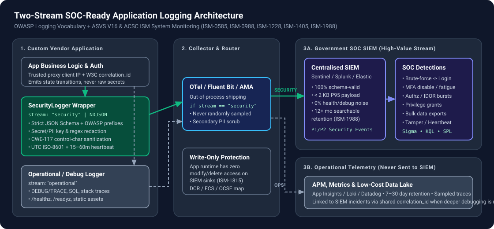
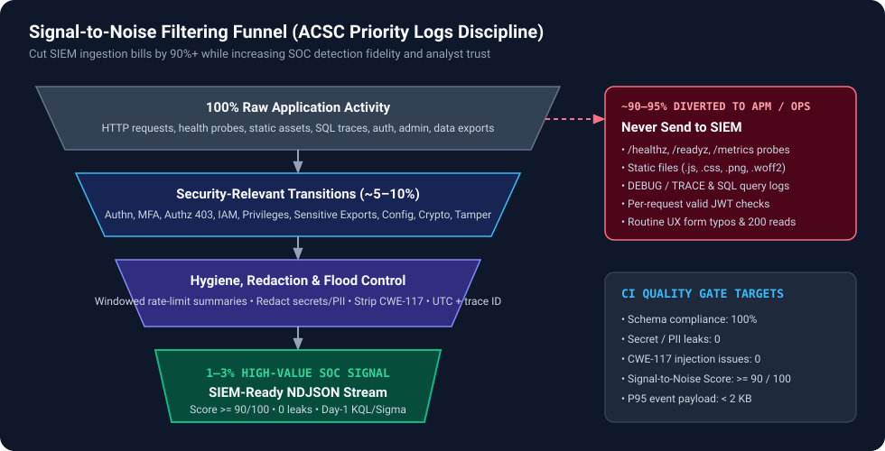
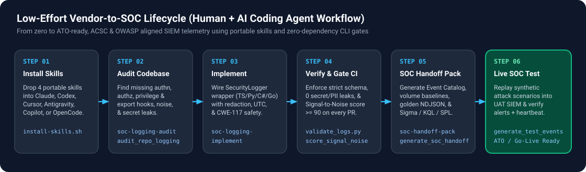

# Architecture & Workflow Diagrams

Each diagram is provided in **both** editable Mermaid source (`.mmd`) and publication-ready standalone SVG (`.svg`) so vendors can drop them straight into Solution Architecture Designs (SADs), System Security Plans (SSPs), and SOC Handoff Packs.

## 1. Two-Stream SOC-Ready Logging Architecture
Separates `stream: "security"` (high-value, schema-validated, never sampled -> Government SOC SIEM) from `stream: "operational"` (debug, health checks, perf -> APM / data lake).

Source: [`architecture-two-stream.mmd`](./architecture-two-stream.mmd)

---

## 2. Signal-to-Noise Filtering Funnel
Illustrates how applying ACSC Priority Logs discipline cuts SIEM ingestion volume by 90%+ while improving SOC detection fidelity.

Source: [`signal-vs-noise-funnel.mmd`](./signal-vs-noise-funnel.mmd)

---

## 3. Low-Effort Vendor-to-SOC Lifecycle
Shows the 6-step human + AI coding agent workflow from installing portable skills to live purple-team verification in a Government SOC SIEM.

Source: [`vendor-to-soc-lifecycle.mmd`](./vendor-to-soc-lifecycle.mmd)
