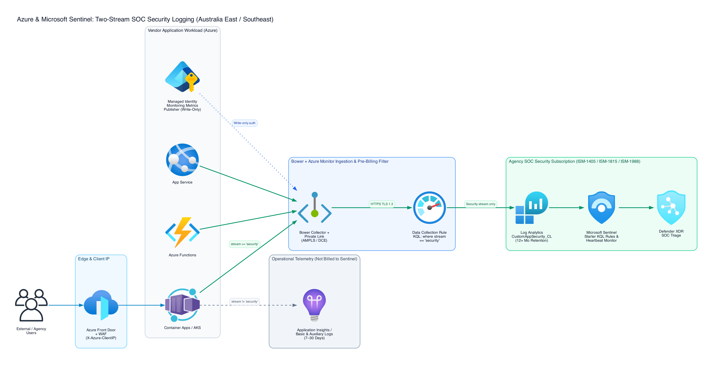

# 08 — Azure & Microsoft Sentinel Implementation Guide

Microsoft Azure and **Microsoft Sentinel** are the most common target stack across Australian Government agencies and regulated enterprises. This guide shows custom software vendors how to implement the **two-stream architecture** cleanly on Azure with zero static secrets, strict noise filtering before ingestion, and full ACSC ISM alignment.



---

## 1. Two-Stream Architecture on Azure

| Stream | Azure Compute Sources | Routing & Transformation | Destination | Retention & Cost |
|---|---|---|---|---|
| **Stream A: Security (`stream == "security"`)** | App Service, Container Apps, AKS, Azure Functions | Managed Identity -> **Azure Monitor Data Collection Endpoint (DCE)** + **Data Collection Rule (DCR)** with KQL filter | **Microsoft Sentinel** Analytics Table (`CustomAppSecurity_CL` or ASIM parser) | 12+ months searchable (ISM-1988); Analytics Rules + Defender XDR |
| **Stream B: Operational (`stream != "security"`)** | Same compute hosts | App Insights SDK / Container Insights / stdout | **Application Insights** or Log Analytics **Basic / Auxiliary** table | 7–30 days; never billed at Sentinel Analytics rate |

> **Why filter in the DCR?** Azure Monitor DCR transformations execute **before** data lands in Log Analytics / Sentinel. Filtering `where stream == "security"` in the DCR guarantees that accidental `DEBUG`, `/healthz`, or operational noise is dropped before incurring Sentinel Analytics ingestion charges.

---

## 2. Recommended Ingestion Path: Logs Ingestion API (DCE + DCR)

Prefer the **Azure Monitor Logs Ingestion API** (with Managed Identity) over legacy HTTP Data Collector API (which is deprecated and relies on shared workspace keys):

1. Create a **Data Collection Endpoint (DCE)** in the agency's Australian region (`australiaeast` or `australiasoutheast`), optionally locked behind **Azure Monitor Private Link Scope (AMPLS)** for private-only workloads.
2. Create a custom table `CustomAppSecurity_CL` (Analytics plan) in the Sentinel Log Analytics workspace matching `schemas/security-event.schema.json`.
3. Create a **Data Collection Rule (DCR)** with an ingestion-time KQL transform that enforces two-stream separation and maps `timestamp` -> `TimeGenerated`:

```kql
source
| where stream == "security"
| where severity in ("INFO", "WARN", "HIGH", "CRITICAL")
| where not(message has_any ("/healthz", "/readyz", "/livez", "/metrics"))
| extend TimeGenerated = todatetime(timestamp)
| project
    TimeGenerated,
    schema_version,
    stream,
    event,
    category,
    severity,
    outcome,
    app,
    actor,
    source = source_info,
    target,
    http,
    correlation_id,
    reason,
    message,
    details,
    compliance
```

*(Note: Because `source` is a reserved keyword in DCR KQL transforms, either rename the incoming JSON key to `source_info` in the collector/Fluent Bit transform or parse it cleanly into `SrcIpAddr` / `Source` columns inside the DCR.)*

4. Assign the application's **User-Assigned Managed Identity** (or AKS Workload Identity) **only** the `Monitoring Metrics Publisher` role scoped to the DCR resource.
   - **ACSC ISM-1815 (Write-Only Isolation)**: This role lets the app/collector *push* events into the DCR, while granting **zero** read, modify, or delete permissions on the Log Analytics workspace or Sentinel incidents.

---

## 3. Container & AKS Pattern (Zero App Coupling)

If your app runs on **AKS** or **Azure Container Apps**, avoid embedding Azure Monitor SDK calls inside business logic:

1. Emit canonical NDJSON (`stream: "security"`) to `stdout` using the reference wrappers in [`examples/`](../examples/README.md).
2. Run **OpenTelemetry Collector** or **Fluent Bit** as a DaemonSet/sidecar that:
   - Routes `stream == "security"` -> Azure Monitor Logs Ingestion API (DCE/DCR) -> Sentinel.
   - Routes `stream != "security"` -> Application Insights / Auxiliary logs.
3. **Want host-side Australian PII redaction, default-deny selection, tamper-evident local buffering, DCR drift checks, and signed Sentinel arrival proof (`bower evidence run`)?** Deploy **[jusso-dev/Bower](https://github.com/jusso-dev/Bower)** ([full guide](./12-normalising-and-shipping-with-bower.md))—it supports both AMA JSONL spooling and the real Azure Monitor Logs Ingestion API (plus Azure Functions isolated worker and legacy SQL Server / Windows Event Log adapters).

---

## 4. True Client IP Behind Azure Front Door & Application Gateway

- **Azure Front Door**: Read `X-Azure-ClientIP` (or `X-Forwarded-For` after validating the `X-Azure-FDID` header and restricting backend ingress to the `AzureFrontDoor.Backend` service tag).
- **Azure Application Gateway / WAF**: Extract the rightmost untrusted IP from `X-Forwarded-For` after stripping known Application Gateway subnet CIDRs.
- **Correlation ID**: Propagate W3C `traceparent` (matches Application Insights & Azure Front Door `X-Azure-Ref` diagnostics) into `correlation_id`.

---

## 5. Azure Checklist for Government ATO / IRAP

- [ ] Data residency pinned to `australiaeast` / `australiasoutheast` (sovereign region as required).
- [ ] Zero shared workspace keys or SAS tokens — Managed Identity / Workload Identity only.
- [ ] App identity has `Monitoring Metrics Publisher` on the DCR only (cannot query/delete Sentinel logs).
- [ ] DCR KQL transform drops non-`security` streams and `DEBUG`/`/healthz` noise prior to billing.
- [ ] Sentinel Analytics rules from [`detections/sentinel-kql/soc-starter-detections.kql`](../detections/sentinel-kql/soc-starter-detections.kql) deployed and tested with `scripts/generate_test_events.py`.
- [ ] Heartbeat absence alert configured (`sys_logging_heartbeat` silent > 90 minutes).
