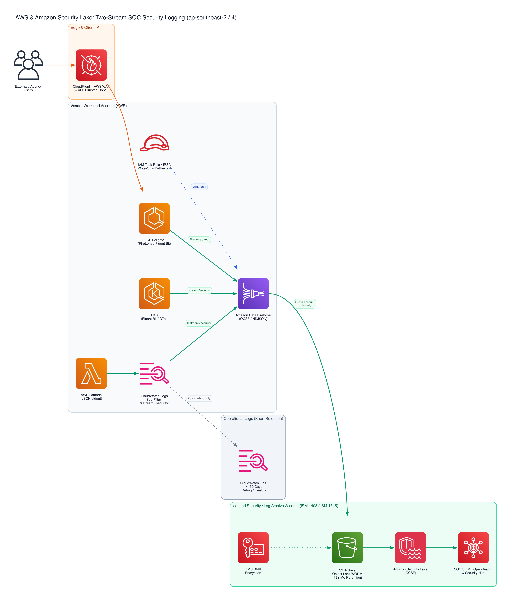

# 09: AWS Security Logging Implementation Guide

This guide shows custom software vendors deploying on **Amazon Web Services (AWS)** how to isolate high-value `stream: "security"` events from noisy operational telemetry, route them cleanly into **Amazon Security Lake (OCSF)** or an agency SIEM, and enforce tamper-resistant multi-account log protection in line with **ACSC ISM** and **OWASP**.



---

## 1. Two-Stream Architecture on AWS

| Stream | AWS Compute Sources | Routing & Filtering | Destination | Retention & Protection |
|---|---|---|---|---|
| **Stream A: Security (`stream == "security"`)** | ECS/Fargate (FireLens), EKS (Fluent Bit / OTel), Lambda, EC2 | CloudWatch Logs Subscription Filter `{ $.stream = "security" }` or FireLens router -> **Amazon Data Firehose** | **Security Tooling / Log Archive AWS Account**: S3 (Object Lock WORM) + **Amazon Security Lake (OCSF)** / Splunk / OpenSearch / Sentinel | 12+ months searchable (ISM-1988), KMS CMK encrypted, immutable Object Lock |
| **Stream B: Operational (`stream != "security"`)** | Same compute hosts | Default `awslogs` / OTel metrics | CloudWatch Logs (14–30 day retention) / X-Ray / low-cost S3 | Never forwarded to SIEM analytics |

---

## 2. Routing Recipes (Copy-Paste)

### Option A: CloudWatch Logs Subscription Filter (Lambda, ECS `awslogs`, App Runner)

Keep emitting single-line JSON to `stdout` and attach a **Subscription Filter** to the log group so only `stream: "security"` events ever enter Amazon Data Firehose:

```text
{ ($.stream = "security") && ($.severity != "DEBUG") && ($.severity != "TRACE") }
```

```bash
aws logs put-subscription-filter \
  --region ap-southeast-2 \
  --log-group-name "/aws/ecs/gov-grants-portal-prod" \
  --filter-name "soc-security-stream-only" \
  --filter-pattern '{ ($.stream = "security") && ($.severity != "DEBUG") }' \
  --destination-arn "arn:aws:firehose:ap-southeast-2:111122223333:deliverystream/soc-security-events" \
  --role-arn "arn:aws:iam::111122223333:role/cw-to-firehose-role"
```

### Option B: ECS FireLens / EKS Fluent Bit (Zero CloudWatch Ingestion Tax on Security Events)

For higher-volume containerised workloads, route directly from **Fluent Bit / FireLens** so you do not pay twice (CloudWatch Logs + Firehose):

```ini
[FILTER]
    Name          rewrite_tag
    Match         app.*
    Rule          $stream ^security$ security.$TAG false
    Rule          $stream ^(?!security$).* operational.$TAG false

[OUTPUT]
    Name          kinesis_firehose
    Match         security.*
    region        ap-southeast-2
    delivery_stream soc-security-events

[OUTPUT]
    Name          cloudwatch_logs
    Match         operational.*
    region        ap-southeast-2
    log_group_name /aws/ecs/gov-grants-portal-ops
    auto_create_group true
```

---

## 3. Amazon Security Lake (OCSF) Integration

If the agency uses **Amazon Security Lake** as its central security data plane:
1. Register your application as a **Custom Source** in Security Lake.
2. Transform canonical `soc-ready-logging` events into **OCSF Parquet** via Firehose / AWS Lambda transformation (using the 1:1 field crosswalk in [`docs/02-event-taxonomy-and-schema.md`](./02-event-taxonomy-and-schema.md)):
   - `authn_*` -> OCSF Class `3002` (Authentication)
   - `user_*` / `priv_*` -> OCSF Class `3001` (Account Change)
   - `api_*` / `authz_*` / `data_*` -> OCSF Class `6003` (API Activity)
3. Subscribe the SOC SIEM (Sentinel, Splunk, Elastic, or Chronicle) as a Security Lake **Subscriber** over S3 + SQS.

> **Open-source normaliser option ([jusso-dev/Bower](https://github.com/jusso-dev/Bower))**: Bower's `bower-cloud` agent + signed `aws-security` pack pulls GuardDuty, Security Hub, high-value CloudTrail (via EventBridge → SQS), and application Bower events (via Firehose → S3) using **IAM role credentials only** (zero stored keys, Australian region pinning), runs host-side Australian PII/secret redaction, and delivers normalised semantic events to Microsoft Sentinel, S3 (`BOWER_OUTPUT=s3`), or Splunk HEC (`BOWER_OUTPUT=http`). See [`12-normalising-and-shipping-with-bower.md`](./12-normalising-and-shipping-with-bower.md).

---

## 4. True Client IP Behind CloudFront, AWS WAF & ALB

- **CloudFront + AWS WAF**: Read `CloudFront-Viewer-Address` (strip port) and enforce origin access via CloudFront managed prefix lists / origin custom secret header.
- **Application Load Balancer (ALB)**: Strip the last `N` trusted proxy hops from `X-Forwarded-For` (`N = 1` for direct internet -> ALB; `N = 2` for CloudFront -> ALB). Never read index `0` blindly.
- **Correlation ID**: Propagate `X-Amzn-Trace-Id` or W3C `traceparent` into `correlation_id`.

---

## 5. AWS Checklist for Government ATO / IRAP

- [ ] Deployed in Australian regions (`ap-southeast-2` Sydney or `ap-southeast-4` Melbourne).
- [ ] Cross-account delivery into an isolated **Log Archive / Security Tooling AWS Account** (ACSC ISM-1405).
- [ ] S3 bucket uses **Object Lock (WORM)**, **Block Public Access**, and **SSE-KMS CMK** encryption (ACSC ISM-1815).
- [ ] Application IAM Task Role / IRSA has **write-only** permissions (`firehose:PutRecordBatch` or `logs:PutLogEvents`); zero `s3:DeleteObject` or `logs:DeleteLogStream`.
- [ ] Firehose backup S3 prefix configured for failed transforms (Dead-Letter Queue) with CloudWatch Alarm on `DeliveryToS3.Success < 1`.
- [ ] Heartbeat absence alarm configured on `sys_logging_heartbeat` (> 90 min silence).
