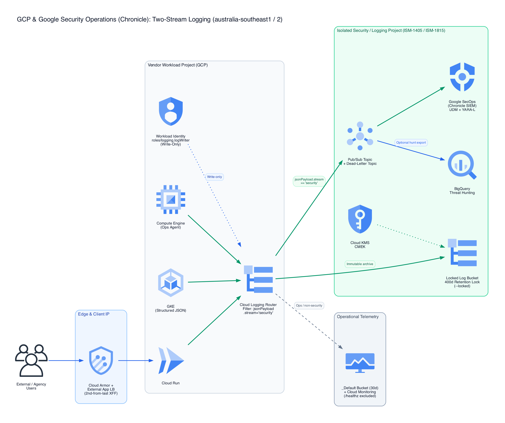

# 10 — GCP & Google Security Operations (Chronicle) Implementation Guide

This guide shows custom software vendors running on **Google Cloud Platform (GCP)** how to separate `stream: "security"` events cleanly in **Cloud Logging Router**, prevent operational noise from inflating SIEM costs, and deliver tamper-evident telemetry into **Google Security Operations (Chronicle SIEM)** or BigQuery in alignment with **OWASP** and **ACSC ISM**.



---

## 1. Two-Stream Architecture on GCP

Cloud Run, GKE, and Compute Engine (Ops Agent) automatically parse single-line JSON written to `stdout` into Cloud Logging's structured `jsonPayload` object—making two-stream routing effortless:

| Stream | GCP Compute Sources | Cloud Logging Router Rule | Destination | Retention & Protection |
|---|---|---|---|---|
| **Stream A: Security (`stream == "security"`)** | Cloud Run, GKE, Compute Engine, Cloud Functions | Inclusion filter: `jsonPayload.stream="security"` | Dedicated **Security Project**: **Pub/Sub** -> **Google Security Operations (Chronicle SIEM)** + **Locked Cloud Logging Bucket** | 12+ months searchable (ISM-1988), Retention Lock (immutable, ISM-1815) |
| **Stream B: Operational (`stream != "security"`)** | Same compute hosts | Default `_Default` bucket with exclusion filters for `/healthz`, static assets, and `DEBUG` | Cloud Logging `_Default` (30d) + Cloud Monitoring / Cloud Trace | Never forwarded to Chronicle / external SIEM |

---

## 2. Cloud Logging Router Sink & Exclusion Filter (Copy-Paste)

### Step 1 — Route Only `stream == "security"` to the Security Project's Pub/Sub Topic

```bash
gcloud logging sinks create soc-security-events-sink \
  "pubsub.googleapis.com/projects/gov-security-logging-prod/topics/app-security-events" \
  --log-filter='jsonPayload.stream="security" AND jsonPayload.severity=("INFO" OR "WARN" OR "HIGH" OR "CRITICAL")' \
  --description="High-value OWASP/ACSC application security events for SOC SIEM"
```

Grant the sink's generated writer identity (`writerIdentity`) **only** `roles/pubsub.publisher` on the target topic in the isolated security project.

### Step 2 — Create a Locked Audit Bucket (ISM-1815 / ISM-1988 Tamper-Evident Archive)

```bash
gcloud logging buckets create soc-security-archive \
  --project=gov-security-logging-prod \
  --location=australia-southeast1 \
  --retention-days=400 \
  --locked
```

> Locking the Cloud Logging bucket makes the 400-day (12+ month) retention policy irreversible—even by Project Owners—directly satisfying ACSC ISM-1815 log tamper protection and ISM-1988 searchable retention.

### Step 3 — Exclude Health Probes & Debug Noise from `_Default`

```bash
gcloud logging sinks update _Default \
  --add-exclusion='name=drop-health-probes,description="Exclude k8s/lb health probes",filter=httpRequest.requestUrl=~"^/(healthz|readyz|livez|metrics)" AND NOT jsonPayload.stream="security"'
```

---

## 3. Google Security Operations (Chronicle SIEM) Ingestion

1. Configure a **Google SecOps Feed** (or Bindplane / OTel Collector) pulling from the `app-security-events` Pub/Sub subscription in the security project.
2. Map canonical `soc-ready-logging` fields to **Google SecOps UDM (Unified Data Model)**:
   - `timestamp` -> `metadata.event_timestamp`
   - `event` -> `metadata.product_event_type`
   - `actor.id` / `actor.username` -> `principal.user.userid` / `principal.user.user_display_name`
   - `source.ip` -> `principal.ip`
   - `target.id` / `target.name` -> `target.resource.product_object_id` / `target.resource.name`
   - `outcome` -> `security_result.action` (`ALLOW` / `BLOCK`)
   - `correlation_id` -> `metadata.product_log_id`
3. Deploy YARA-L rules corresponding to [`detections/`](../detections/README.md) (brute-force-then-success, 403 IDOR burst, privilege grant, bulk export, tamper, and `sys_logging_heartbeat` absence).

> **Open-source normaliser option ([jusso-dev/Bower](https://github.com/jusso-dev/Bower))**: Need GCP Security Command Center findings, Admin Activity audit logs, and custom Cloud Run/GKE app security events normalised onto one contract with host-side Australian PII redaction and delivered to Microsoft Sentinel, S3, or Splunk HEC? Bower's signed `gcp-security` pack + Terraform consumes Pub/Sub via **Workload Identity Federation / ADC (key files refused)** with Australian region pinning. See [`12-normalising-and-shipping-with-bower.md`](./12-normalising-and-shipping-with-bower.md).

---

## 4. True Client IP Behind Cloud Armor & Global Load Balancer

- On **Google Cloud External Application Load Balancer**, Google Front End appends `<client_ip>, <lb_ip>` to `X-Forwarded-For`. Read the **second-from-last IP** (never index `0`, which an attacker can spoof!).
- Propagate `X-Cloud-Trace-Context` or W3C `traceparent` into `correlation_id`.

---

## 5. GCP Checklist for Government ATO / IRAP

- [ ] Resources & log buckets pinned to `australia-southeast1` (Sydney) or `australia-southeast2` (Melbourne) with Org Policy `constraints/gcp.resourceLocations`.
- [ ] Security logs routed to a **separate Security/Logging GCP Project** with a **Locked Log Bucket** (`--locked`) and CMEK (Cloud KMS) encryption.
- [ ] Workload service accounts hold only `roles/logging.logWriter` (zero `logging.logs.delete` or `logging.buckets.update`).
- [ ] Pub/Sub dead-letter topic configured with Cloud Monitoring alert on unacked message age > 5 minutes.
- [ ] `sys_logging_heartbeat` silence alert configured in Chronicle / Cloud Monitoring (> 90 minutes).
