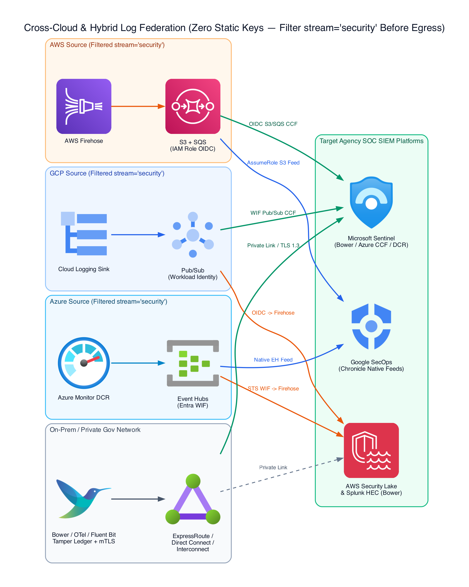

# 11 — Cross-Cloud & Hybrid Log Federation Guide

In government and enterprise environments, the vendor's hosting cloud and the agency's SOC SIEM **frequently do not match**:
- Vendor SaaS or custom app runs on **AWS** or **GCP**, while the agency SOC operates **Microsoft Sentinel (Azure)**.
- Vendor runs on **Azure** or **GCP**, while the agency aggregates into **AWS Security Lake / Splunk**.
- Vendor runs on **Azure**, **AWS**, or **on-premises**, while the agency operates **Google Security Operations (Chronicle)**.

This guide provides **battle-tested, zero-static-secret patterns** for moving `stream: "security"` logs reliably between clouds without blowing egress budgets or breaking forensic integrity.

---

## 1. Golden Rules Before Crossing Cloud Boundaries

1. **Filter FIRST inside the source cloud**: Apply the `stream == "security"` filter *before* any cross-cloud transfer. Dropping 90–95% operational noise at the origin eliminates cross-cloud egress fees and prevents SIEM ingestion overages.
2. **Zero long-lived static credentials**: Never share static AWS IAM access keys, GCP service account JSON key files, or Azure workspace shared keys across vendor/agency boundaries. Use **OIDC Workload Identity Federation (WIF)**, **IAM Role AssumeRole with ExternalId**, or **mTLS** everywhere.
3. **Buffer with durable queues + Dead-Letter Queues (DLQ)**: Never push synchronously from an application HTTP request to a remote cloud SIEM. Always buffer through an async queue/bucket (SQS+S3, Pub/Sub, Event Hubs, or local disk-backed OTel Collector) so a transient WAN or SIEM API blip never loses P1 security events.
4. **Preserve original `timestamp`, `source.ip`, and `correlation_id`**: Cross-cloud transport adds 5–60 seconds of pipeline latency. Always preserve the original UTC `timestamp` field from the app so cross-system timelines stay exact (ACSC ISM-0988).
5. **Prove the cross-cloud bridge is alive**: Monitor `sys_logging_heartbeat` at the **destination SIEM**. A single missing-heartbeat alert catches broken OIDC federation, expired certs, firewall changes, or paused connectors automatically.

---

## 2. Inter-Cloud Transport Matrix

> **Unified open-source option — [jusso-dev/Bower](https://github.com/jusso-dev/Bower)**: Instead of stitching together different connectors and redaction rules per cloud, **Bower** (`bower-cloud` + signed `aws-security` / `gcp-security` packs) ingests custom apps, legacy SQL Server / Windows Event Logs, AWS (EventBridge→SQS / Firehose→S3, IAM roles only), and GCP (Pub/Sub, WIF only—key files refused) through **one deterministic host-side Australian PII redaction engine and default-deny policy**, then delivers with a tamper-evident queue ledger to **Microsoft Sentinel**, **S3**, or **Splunk HEC / HTTP NDJSON**—and proves arrival with `bower evidence run`. See [`12-normalising-and-shipping-with-bower.md`](./12-normalising-and-shipping-with-bower.md).

| Source Environment | Destination SIEM | Recommended Pattern (Preferred) | Alternative / Low-Ops Pattern | Authentication |
|---|---|---|---|---|
| **AWS** | **Azure (Microsoft Sentinel)** | CloudWatch Filter / FireLens -> Firehose -> **S3 + SQS** -> **Sentinel AWS S3 Codeless Connector (CCF)** | OTel Collector / [`jusso-dev/Bower`](https://github.com/jusso-dev/Bower) -> Azure Monitor **DCE/DCR Logs Ingestion API** | AWS IAM Role + **Entra OIDC Trust** (no IAM keys!) |
| **GCP** | **Azure (Microsoft Sentinel)** | Cloud Logging Sink (`jsonPayload.stream="security"`) -> **Pub/Sub** -> **Sentinel GCP Pub/Sub CCF Connector** | Dataflow / OTel Collector -> Azure Monitor **DCE/DCR** | GCP **Workload Identity Federation** -> Entra ID (no JSON key files!) |
| **Azure** | **AWS (Security Lake / Splunk / OpenSearch)** | DCR / Diagnostic Settings -> **Azure Event Hubs** -> AWS Lambda / OTel Collector -> **Amazon Data Firehose -> S3 / Security Lake** | Cribl / Fluent Bit in Azure -> AWS Firehose / Splunk HEC | Entra Workload Identity -> AWS STS `AssumeRoleWithWebIdentity` |
| **Azure** | **GCP (Google SecOps / Chronicle)** | DCR -> **Azure Event Hubs** (or Blob Storage) -> **Google SecOps Native Azure Event Hub / Blob Feed** | Bindplane / OTel Collector -> SecOps Ingestion API | Entra App / Managed Identity + WIF |
| **AWS** | **GCP (Google SecOps / Chronicle)** | Firehose -> **S3 + SQS** -> **Google SecOps Native Amazon S3 SQS Feed** | OTel Collector / Bindplane -> SecOps Ingestion API | AWS IAM Role `AssumeRole` + ExternalId |
| **GCP** | **AWS (Security Lake / Splunk)** | Cloud Logging Sink -> **Pub/Sub** -> Pub/Sub Push / Dataflow / OTel Collector -> **Firehose -> S3 / Security Lake** | Cloud Storage export -> AWS transfer | GCP Service Account -> AWS STS OIDC WIF |
| **On-Prem / Private Gov Network** | **Any Cloud SIEM** | App stdout/file -> **OTel Collector / Fluent Bit** (persistent disk queue) -> ExpressRoute / Direct Connect / Interconnect -> SIEM Private Endpoint | [`jusso-dev/Bower`](https://github.com/jusso-dev/Bower) for custom/legacy apps targeting Sentinel | mTLS / Managed Identity / Private Link |

---

## 3. Deep-Dive Recipes for the Most Common Government Paths

### Pattern A — AWS Application -> Agency Microsoft Sentinel (Azure)

This is the #1 multi-cloud pattern in Australian Government (vendor hosts on AWS Sydney; agency SOC runs Microsoft Sentinel in Azure Australia East):

1. **In AWS (Vendor Account)**:
   - Filter to `stream == "security"` via CloudWatch Subscription Filter or FireLens -> Amazon Data Firehose -> encrypted **S3 bucket** (NDJSON `.gz`, 60-second buffer).
   - Enable S3 Event Notifications (`s3:ObjectCreated:*`) to an **SQS queue** (with SQS Dead-Letter Queue).
   - Create an IAM Role trusting Microsoft Sentinel's OIDC identity (`sts:AssumeRole` with `ExternalId`), granting **read-only** `s3:GetObject`, `sqs:ReceiveMessage`, `sqs:DeleteMessage`, and `kms:Decrypt` on that bucket/queue only.
2. **In Azure (Agency Sentinel)**:
   - Configure the **Microsoft Sentinel Amazon Web Services S3 (CCF)** connector pointing to the SQS queue URL and IAM Role ARN.
   - Map incoming NDJSON into `CustomAppSecurity_CL` via a DCR transformation (`TimeGenerated = todatetime(timestamp)`).
3. **Verify**: Run `scripts/generate_test_events.py --scenario all` into the AWS app/Firehose stream -> confirm arrival in Sentinel within 2–5 minutes and confirm the KQL rules fire.

---

### Pattern B — GCP Application -> Agency Microsoft Sentinel (Azure)

1. **In GCP (Vendor Project)**:
   - Create a Cloud Logging Router Sink with filter `jsonPayload.stream="security"` targeting a dedicated **Pub/Sub topic** + pull subscription (with a Dead-Letter Topic).
   - Configure a **Workload Identity Pool** trusting Microsoft Entra ID (eliminating exported JSON service account keys) and grant `roles/pubsub.subscriber` on the single subscription.
2. **In Azure (Agency Sentinel)**:
   - Connect via Sentinel's **GCP Pub/Sub** connector using the Workload Identity Federation config and subscription path.
   - Transform `jsonPayload` fields into `CustomAppSecurity_CL` via DCR.

---

### Pattern C — Azure Application -> Agency AWS Security Lake or Splunk

1. **In Azure (Vendor Subscription)**:
   - Stream `stream == "security"` events via DCR or app collector into a dedicated **Azure Event Hub** (with Private Endpoint & retention >= 7 days for replay safety).
2. **Bridge to AWS**:
   - Run an **OpenTelemetry Collector** (on AKS/Container Apps) or lightweight AWS consumer reading from Event Hubs (via Entra Workload Identity -> AWS STS `AssumeRoleWithWebIdentity`) and pushing batches into **Amazon Data Firehose** -> **S3 / Amazon Security Lake (OCSF)** or **Splunk HEC**.

---

### Pattern D — On-Premises / Hybrid Government Network -> Cloud SIEM

For air-gapped-adjacent or private-networked government data centres:

1. Deploy a local **OpenTelemetry Collector** or **Fluent Bit** relay inside the agency DMZ/management VLAN with **persistent disk buffering** (`storage.type: filesystem`, e.g., 10 GB buffer) so logs survive link outages.
2. Filter on `stream == "security"` locally before egress.
3. Ship over **Azure ExpressRoute + AMPLS**, **AWS Direct Connect + PrivateLink**, or **Google Cloud Interconnect + Private Service Connect** using TLS 1.3 / mTLS.
4. Monitor `sys_logging_heartbeat` arrival in the destination SIEM and alert on local collector disk-buffer backpressure (`> 70%`).

---

## 4. Cross-Cloud Resilience & Governance Checklist

- [ ] **No static keys**: Verified OIDC / Workload Identity Federation / IAM Role trust on every hop.
- [ ] **Filter before egress**: Only `stream == "security"` crosses cloud boundaries (confirmed with `score_signal_noise.py >= 90`).
- [ ] **Data sovereignty**: Both source buffer (S3 / Pub/Sub / Event Hubs) and destination SIEM remain in approved Australian regions (`ap-southeast-2`/`4`, `australiaeast`/`southeast`, `australia-southeast1`/`2`).
- [ ] **Dead-letter & replay tested**: Simulated destination outage confirms events queue safely and drain without loss or duplication once connectivity returns.
- [ ] **End-to-end latency & heartbeat verified**: `sys_logging_heartbeat` arrives end-to-end in `< 5 minutes` with exact original UTC `timestamp` preserved.
