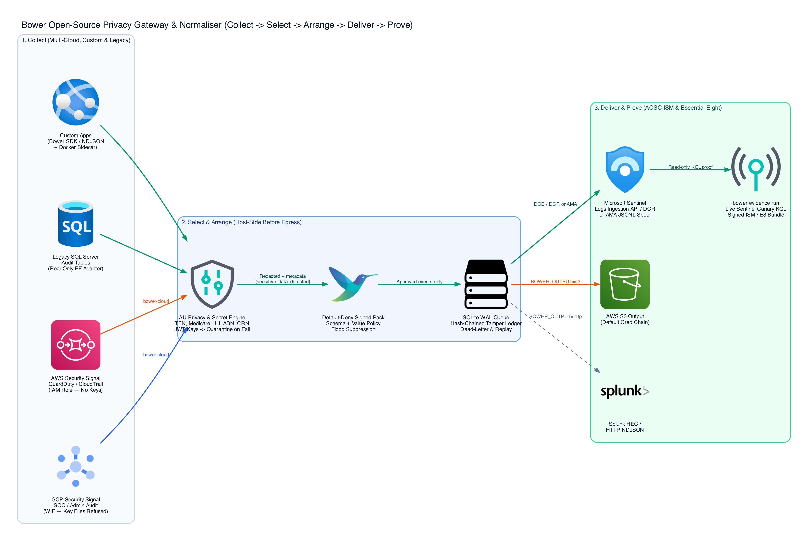

# 12 — Normalising, Redacting & Proving Delivery with Bower

Writing clean structured security events inside your application is half the battle. In government and regulated Australian environments, teams still have to solve:

- **Deterministic host-side redaction** of Australian-regulated identifiers (TFN, Medicare, IHI, ABN/ACN, CRN) and leaked secrets *before* data ever leaves the host
- **Default-deny noise control** so unapproved or accidental noisy events never reach the SIEM
- **Tamper-evident buffering & delivery accounting** when network links or SIEM endpoints hiccup
- **Multi-cloud & legacy normalisation** (bringing AWS, GCP, legacy SQL Server audit tables, Docker containers, and Windows Event Logs onto one semantic contract)
- **Actual proof of arrival** in Microsoft Sentinel for IRAP / ATO evidence (not just "HTTP 202 accepted")

Rather than re-inventing all of that from scratch in every vendor project, pair this repository with our open-source security telemetry privacy gateway: **[jusso-dev/Bower](https://github.com/jusso-dev/Bower)** ([Documentation](https://jusso-dev.github.io/Bower/)).



---

## Why Pair `soc-ready-logging` with Bower?

Inspired by the Australian bowerbird, **Bower** follows **Collect → Select → Arrange → Deliver → Prove**—deliberately selecting, redacting, and arranging high-value security signal instead of forwarding every log.

| Challenge in Government SOC Onboarding | How Bower Solves It |
|---|---|
| **Australian PII & secret leaks before egress** | Deterministic host-side **Privacy & Secret Protection Engine** (no AI at runtime): checksum-validated **TFN, Medicare, IHI, ABN/ACN, payment cards** + pattern-matched **CRN**, cloud keys, JWTs, PEM/SSH keys. Runs *before* persistence or forwarding; any failure quarantines; high-risk leaks emit a `sensitive_data_detected` SOC alert without exposing original values. |
| **Noise creeping back into the SIEM** | **Default-deny versioned policy**: only event types explicitly approved in a signed Bower Pack are accepted; everything else is rejected with structured decision evidence, plus per-key flood suppression with summary events. |
| **Silent drops & log tampering (ISM-1815)** | **Durable SQLite WAL queue** with a **tamper-evident hash-chained ledger** (head witnessed by the management plane), bounded outage buffering, dead-letter holding, audited replay, and source-silence detection. |
| **DCR drift & ingestion surprises (Azure)** | Schema-driven **DCR ARM generator**, offline/live **DCR drift checks**, ingestion preflight, and Australian region endpoint checks. |
| **Multi-cloud & legacy sources on one contract** | Ingests custom apps (Bower SDK + generated `AGENTS.md`), **legacy SQL Server audit tables** (`Bower.Source.SqlServer`, read-only EF Core adapter), Docker containers (`Bower.Agent.Docker`), Windows Event Logs, **AWS** (`bower-cloud` via EventBridge/SQS + Firehose/S3, IAM roles, zero stored keys), and **GCP** (SCC & Admin Audit via Pub/Sub, WIF, key files refused). |
| **Multiple SIEM destinations** | Ships to **Microsoft Sentinel** (Azure Monitor Logs Ingestion API or AMA JSONL spool), **AWS S3** (`BOWER_OUTPUT=s3`), or **Splunk HEC / generic HTTP NDJSON** (`BOWER_OUTPUT=http`). |
| **IRAP / ATO proof that logs actually arrived** | `bower evidence run` sends a canary through the real collector, queries Sentinel with KQL under a separate read-only identity, records latency/retention/region, maps results to **ACSC ISM & Essential Eight** controls, and signs the evidence bundle. |

> **Honest status note**: Check Bower's [project status & production readiness gates](https://github.com/jusso-dev/Bower#project-status) before deploying to production—Bower publishes transparent, recorded pilot & qualification evidence for every release path.

---

## Quickstart: Running Bower Locally with Your Application

1. **Emit canonical events** from your application using this repo's schema (`schemas/security-event.schema.json`) or the Bower SDK.
2. **Start a local Bower collector** (see the full [Bower Getting Started Guide](https://jusso-dev.github.io/Bower/getting-started/)):

```bash
git clone https://github.com/jusso-dev/Bower.git
cd Bower

BOWER_SINGLE_TRUST_DOMAIN=true \
BOWER_QUEUE_PATH=./artifacts/bower.db \
BOWER_POLICY_DIRECTORY=./policies/default \
BOWER_OUTPUT=ama-spool \
BOWER_AMA_SPOOL_PATH=./artifacts/spool \
dotnet run --project src/Bower.Collector
```

3. **Emit a synthetic test event and inspect the policy & redaction decision**:

```bash
dotnet run --project src/Bower.Cli -- test emit
dotnet run --project src/Bower.Cli -- queue inspect --database ./artifacts/bower.db
```

4. **Generate signed Sentinel arrival evidence for your SOC Handoff Pack / IRAP pack**:

```bash
# Runs canary -> real collector -> Sentinel KQL arrival query -> signed ISM/E8 bundle
bower evidence run
```

---

## Choosing Between Direct Cloud Collector vs. Bower

| Scenario | Recommended Path |
|---|---|
| Greenfield single-cloud app with existing OTel/DCR pipeline and simple schema | Emit `stream: "security"` NDJSON directly via [`examples/`](../examples/README.md) + cloud-native router (`docs/08`–`10`) + CI gates (`scripts/validate_logs.py`) |
| **Australian Government / regulated app** needing host-side checksum-validated TFN/Medicare/IHI redaction, default-deny policy, tamper-evident local queue, or signed Sentinel arrival proof | **Use [Bower](https://github.com/jusso-dev/Bower)** as your host/sidecar security telemetry privacy gateway |
| **Legacy app / SQL Server audit table / Windows Event Log / multi-cloud AWS+GCP -> Sentinel** | **Use [Bower](https://github.com/jusso-dev/Bower)** (`Bower.Source.SqlServer`, `bower-cloud`, signed Packs) to normalise everything onto one semantic contract |
